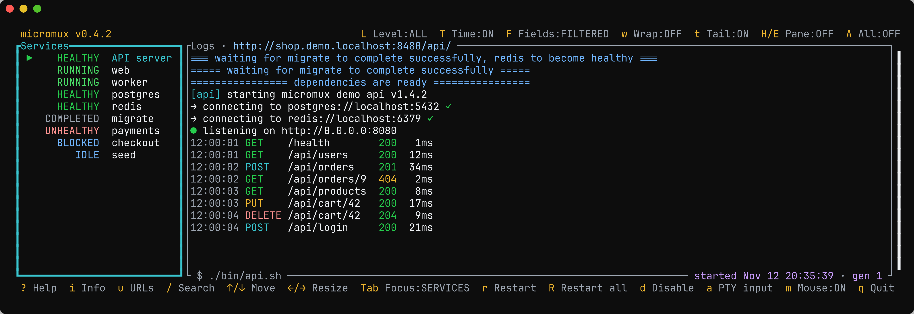
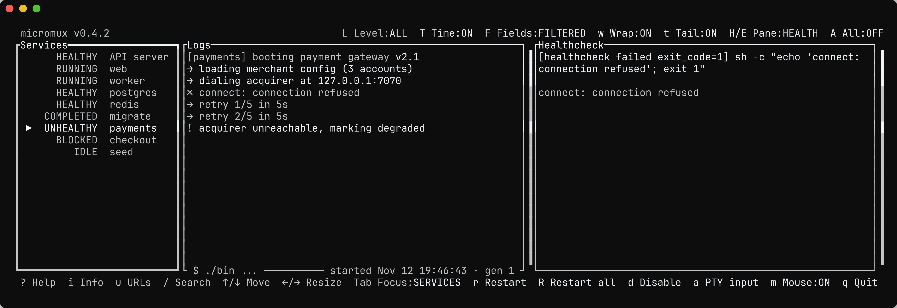
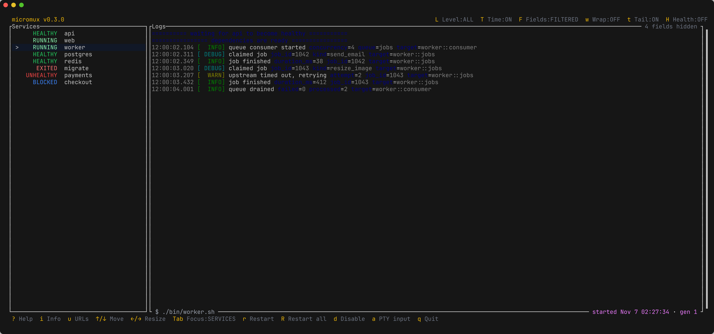

# micromux

[](https://github.com/romnn/micromux/actions/workflows/build.yaml)
[](https://github.com/romnn/micromux/actions/workflows/test.yaml)
[](https://deps.rs/repo/github/romnn/micromux)
[](https://docs.rs/micromux)
[](https://crates.io/crates/micromux)

Micromux is a **local process supervisor with a terminal UI**: Docker Compose for the processes of
your dev stack, without the containers.

**Documentation: [romnn.github.io/micromux](https://romnn.github.io/micromux/)**

<picture>
  <source media="(prefers-color-scheme: light)" srcset="https://raw.githubusercontent.com/romnn/micromux/main/docs/static/images/overview-light.png">
  
</picture>

- **One place for every service**: live logs, state, restart, disable, and input to a service's
  terminal.
- **Starts in the right order**: dependencies wait for healthchecks or for jobs to complete.
- **Jobs** for migrations and seeds that run once, on start or on demand.
- **Worktree-friendly**: allocated ports and hostnames like `http://app.my-project.localhost`, so
  several checkouts run side by side.
- **Built for coding agents**: an MCP server lets Claude Code or Codex read logs, restart services
  and wait for health.

## Install

```bash
brew install --cask romnn/tap/micromux

# Or from source
cargo install --locked micromux-cli
```

## Quick start

Put a `micromux.yaml` in your project and run `micromux` in that directory:

```yaml
# yaml-language-server: $schema=https://github.com/romnn/micromux/raw/main/micromux.schema.json
version: "1"
restart: unless-stopped

services:
  postgres:
    command: docker compose up postgres
    cleanup:
      command: docker compose down
    healthcheck:
      test: ["CMD-SHELL", "pg_isready -h localhost"]

  migrate:
    kind: job
    command: ./scripts/migrate.sh
    depends_on:
      - name: postgres
        condition: healthy

  api:
    command: ./run-api
    env_file: .env
    depends_on:
      - migrate # waits for the job to complete
    healthcheck:
      test: ["CMD-SHELL", "curl -fsS http://localhost:8080/health"]
```

Press `?` in the TUI for every key. The essentials:

| Key | Action |
|---|---|
| `j` / `k` | Select a service |
| `r` / `R` | Restart the service / all services |
| `d` | Disable or enable the service |
| `a` | Type into the service's terminal (`Ctrl+]` leaves) |
| `H` | Show the healthcheck pane |
| `/` | Search the service's logs; `n` / `N` move between matches |
| `i` / `u` | Describe the service / the session's URLs and ports |
| `q` | Quit |

<picture>
  <source media="(prefers-color-scheme: light)" srcset="https://raw.githubusercontent.com/romnn/micromux/main/docs/static/images/healthcheck-light.png">
  
</picture>

## Features

### Jobs

`kind: job` runs a command to completion, like a migration or a seed. A dependency on a job waits
for it to complete. Add `run: manual` to run it only when you restart it.
See [Jobs](https://romnn.github.io/micromux/docs/configuration/services/#jobs).

### Ports and hostnames

Give each checkout its own ports and browser URLs, so git worktrees never collide:

```yaml
session:
  name: shop # defaults to the directory name

allocate_ports: # stable, free ports, injected as env vars
  - API_PORT
  - { name: WEB_PORT, prefer: 3000 } # 3000 whenever it is free

routes:
  - host: app # http://app.shop.localhost
    port: ${WEB_PORT}
  - host: app # http://app.shop.localhost/api/
    path: /api/
    port: ${API_PORT}
```

A shared `micromux proxy` serves the routes and starts on its own.
See [Sessions, ports, and hostnames](https://romnn.github.io/micromux/docs/configuration/sessions/).

### Structured logs

JSON logs render as compact, colored lines. Filter them by level (`L`), toggle timestamps (`T`), and
hide noisy fields (`F`, or `logs.fields` in the config).
See [Logs](https://romnn.github.io/micromux/docs/configuration/logs/).

<picture>
  <source media="(prefers-color-scheme: light)" srcset="https://raw.githubusercontent.com/romnn/micromux/main/docs/static/images/structured-logs-light.png">
  
</picture>

### Agent control (MCP)

Agents act through the same control plane as the TUI, so dependencies, healthchecks and restart
policies still apply. Register the MCP server once:

```bash
claude mcp add micromux -- micromux mcp
```

For Codex, add it to `~/.codex/config.toml`:

```toml
[mcp_servers.micromux]
command = "micromux"
args = ["mcp"]
```

Agents can then find services across sessions, read and follow logs, diagnose failures, restart a
service and wait for its new run to become healthy.
See [Agent control](https://romnn.github.io/micromux/docs/agent-control/).

### From the shell

```bash
micromux ctl restart api
micromux ctl wait api                     # until healthy, or fail fast
micromux exec ./scripts/seed.sh           # with the session's ports and variables
micromux attach                           # TUI for a headless `micromux serve` session
```

See [the control plane](https://romnn.github.io/micromux/docs/agent-control/control-plane/).

## How it compares

- **Docker Compose** runs containers. Micromux runs your existing scripts and binaries on the host:
  no images, networks or volumes, and nothing to rebuild.
- **tmux** gives you terminals. Micromux knows what runs in them: states, restart policies,
  healthchecks and dependencies.

Linux and macOS are fully supported. On Windows the TUI works, but the control plane and the proxy
do not yet. See [Comparisons](https://romnn.github.io/micromux/docs/comparisons/).
